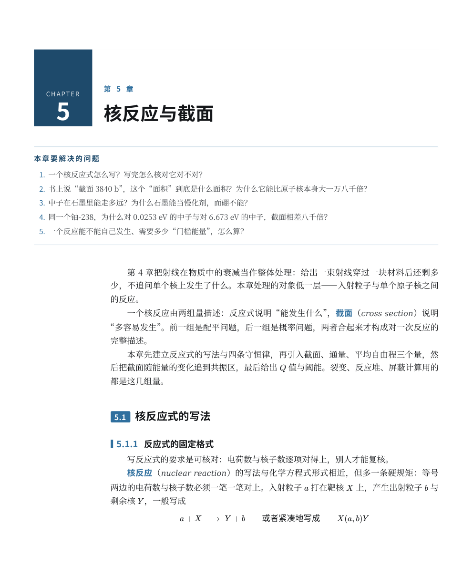
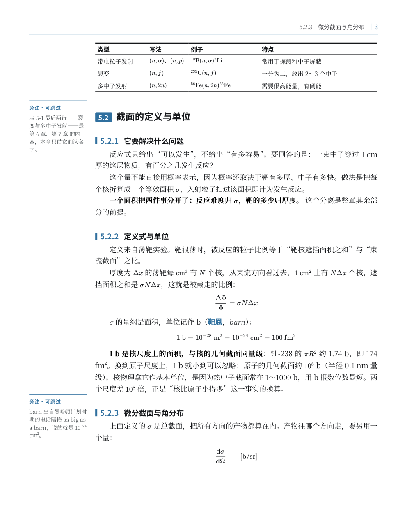
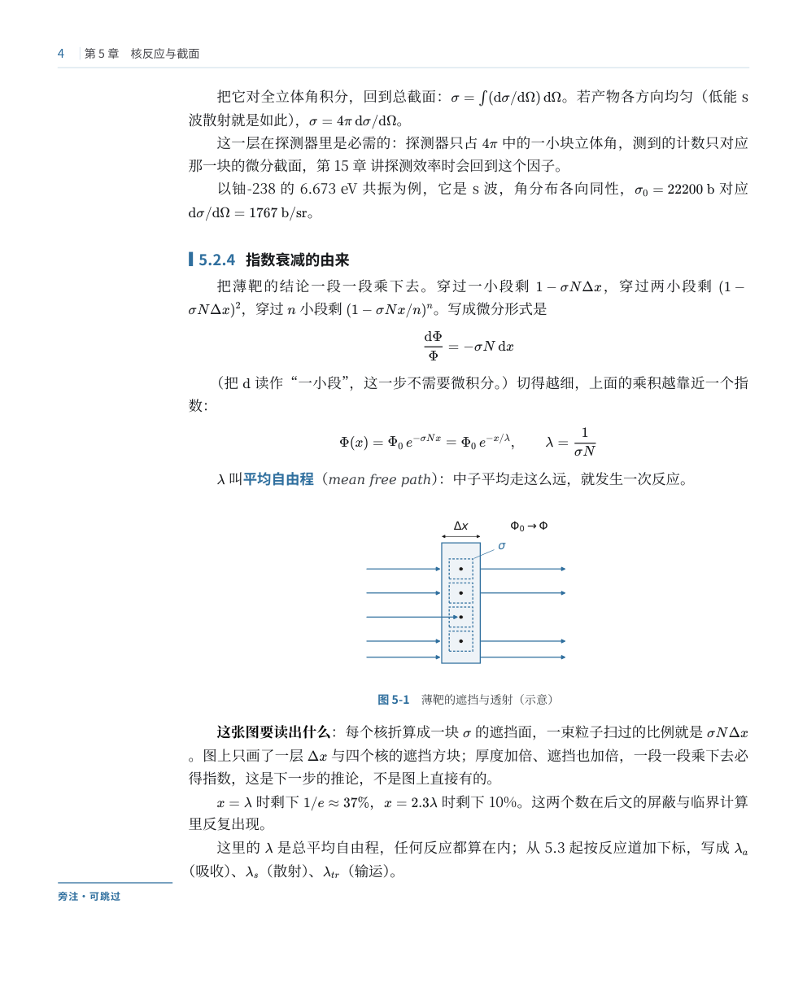
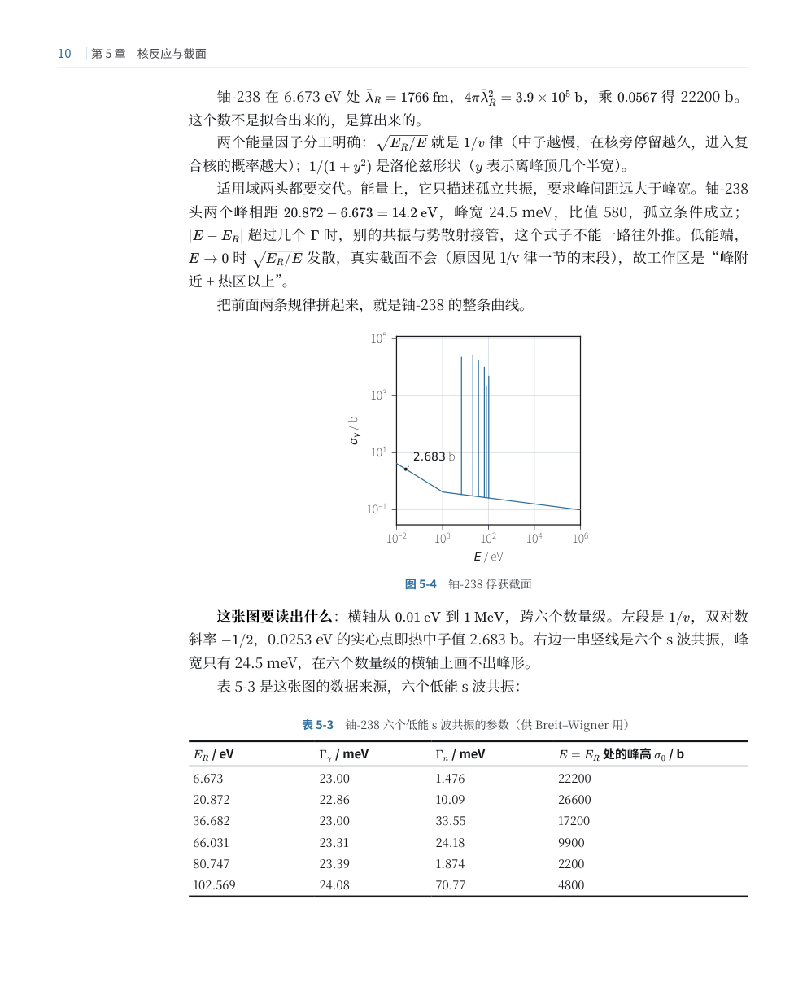
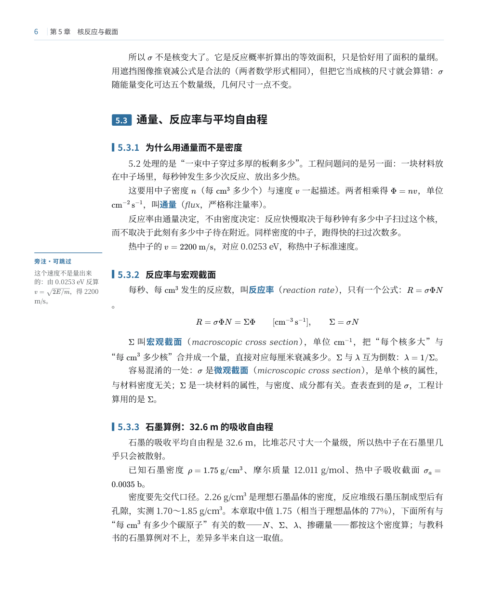
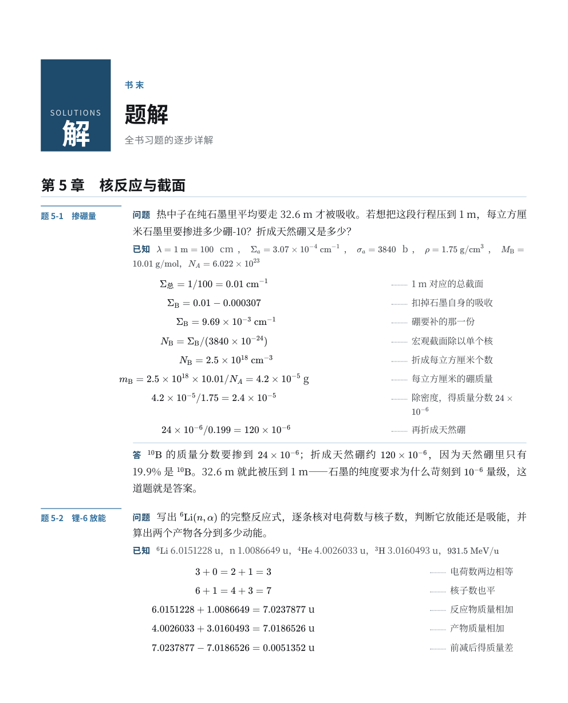

# cn-textbook-layout-kit

[简体中文](README.md)

Write a book in Markdown, typeset it as a Chinese textbook PDF at 210 × 260 mm.

A 34 mm side column on the left holds margin notes and problem numbers, so the main text runs uninterrupted. Column widths in three-line tables are computed from content instead of guessed as percentages. Figures are SVG, and their lettering stays vector, so the type survives zooming. Back matter gets a solutions chapter, appendices and a term index.

The page design follows *Basic Organic Chemistry*, 4th edition (Peking University Press). Only the layout conventions are borrowed; none of its content is included.

## What it is

A typesetting kit for Chinese textbooks. Two skills cover the workflow and the acceptance criteria; the 22 Python tools in `src/` handle assembly, figure output and checks; and `assets/` holds the templates and sample pages.

### What it looks like
| | |
|---|---|
|  |  |
| Chapter opener: the colour block on the left carries the chapter number, body text starts to the right of the side column | Three-line table: 1.5 pt above and below, 0.75 pt under the header, widths computed from content |
|  |  |
| Diagram at 58 mm, every label kept, lettering inside the figure is the same 8.5 pt as the caption | Data figure at 65 mm, no explanatory text inside, just axes and curves |
|  |  |
| Margin note in the left side column, body text continues as usual | Solutions chapter: problem / solution (formula, dashed rule, working) / answer |

The finished sample is `assets/samples/样张-第5章.pdf`, 20 pages, 2.5 MB. The Markdown for the body text and the solutions is in the same directory, ready to edit.

### Specifications
| | |
|---|---|
| Trim size | 210 × 260 mm |
| Margins | 22 mm head, 15 mm foot, 15 mm left and right |
| Type area | 180 × 223 mm: 34 mm side column + 146 mm main column |
| Body text | 10.5 / 17.2 pt, 39 characters × 36 lines |
| Running head | baseline 15 mm from the top edge, hairline at 17.6 mm; folio at the trim edge, chapter title on versos, section title on rectos |
| Colour | black plus ink blue `#2f6f9f` (chapter block `#1e4a6b`) |
| Figures | width ≤ 65 mm (named wide figures ≤ 180 mm), height ≤ 78 mm, lettering 8.5 pt; axes and curves 0.75 pt, grid 0.4 pt |
| Tables | 1.5 pt rules above and below, 0.75 pt under the header; 9.5 pt type; the first column always fits on one line |
| Front matter | cover (right-aligned title, red edition mark, repeating pattern across the top) → blank verso → copyright page → contents (three levels, one two-column block per chapter) |

## How to use
```
book/
  src/ch01.md           chapter text
  src/tijie_ch01.md     solutions (HTML fragments)
  src/part0.md          front matter text
  code/fig_ch01.py      figure scripts (optional)
  图/                   figure output
  版式/                  copy assets/templates/ and src/ here
```

```bash
cd 书目录/版式

# single chapter: check the pipeline first
python3 工具/figs.py ch01                 # generate figures first, if any
cp assets/templates/src/template.html src/         # first time only
PYMUPDF=python3 ./build.sh ch01 ch01.md tijie_ch01.md

# whole book: cover → copyright page → contents → front matter → chapters → solutions → appendices A–E
CHAPTERS="01 02" OUTNAME=试装 ./build_book.sh
OUTNAME=全书 ./build_book.sh
```

`build.sh` runs these steps in order: resolve `{{ref:}}` cross-references, pull in-chapter exercises out and keep only their stems, rewrite figure references to `.svg`, convert to HTML with pandoc, shape the document with `shape.py`, print through Chromium, then add running heads, folios and bookmarks with `finish.py`.

`build_book.sh` adds the cover, copyright page, three-level contents and appendices on top of that, and finally writes the real page numbers back into the contents and the term index.

After a build, measure the type size first: `python3 skills/book-typography-cn/src/measure_pdf.py out/sample.pdf`. Body text should read 10.4–10.6 pt. If you get 8.7 pt, the whole page has been scaled down; see item 1 under Scope.

A full build takes about three and a half minutes, three of which go to Chromium's paginated rendering. When revising, rebuild only the chapter you changed.

## Layout
```
skills/hep-textbook-rebuild/   whole-book rebuild workflow: thirty pitfalls, subagent task templates, assembly and scaling diagnostics
skills/book-typography-cn/     general Chinese book typography plus the measuring scripts
src/                           22 Python tools, plus Figure Specification v3
assets/templates/              template.html (all the CSS) + build.sh (one chapter) + build_book.sh (whole book)
assets/samples/                chapter 5 text, solutions, the 20-page PDF, six sample pages
```

| Tool | Purpose |
|---|---|
| `shape.py` | Chapter-opening colour block, section tabs, three-level heading numbers, margin-note placement, end-of-chapter exercise stems, fixed table widths, figure width decisions, solutions column widths |
| `finish.py` | Running heads, folios, bookmarks (drawn afterwards with PyMuPDF) |
| `make_front.py` `make_cover.py` | Copyright page and three-level contents; repeating pattern at the top of the cover |
| `make_appendix.py` | Builds Appendix D (term index, pinyin order) and Appendix E (list of figures) from the finished chapters |
| `toc_pages.py` `index_pages.py` | Read the real page numbers back out of the finished PDF and write them into the contents and index |
| `normalize_captions.py` `fix_quotes.py` | Move table captions below the table; convert straight quotes to Chinese quotation marks |
| `figs.py` `bookstyle.py` `figstyle_v3.py` | Figure output: two colours plus vector SVG lettering, canvas calibrated to the printed width |
| `figcheck.py` | Check SVGs against Figure Specification v3: dimensions, base font size, line-weight steps |
| `文风检查.py` `验收章.py` `规范检查.py` `term对齐.py` | AI-flavoured prose and bold density, chapter skeleton checks, GB 3100/3101/3102 violations, glossary vs first-mention alignment |
| `对照图.py` `线宽.py` `pages.py` `check_left.py` `measure.py` | Old and new pages side by side, line-width measurement, page extraction, left-edge measurement, deriving layout parameters from a page image |

## Requirements
pandoc, Chromium/Chrome, python3 (matplotlib, Pillow), PyMuPDF, an offline KaTeX bundle, Noto Serif/Sans CJK SC.

If PyMuPDF is not in the system python, point the build at another interpreter with `PYMUPDF=<interpreter>`. `finish.py`, `toc_pages.py` and `index_pages.py` all need it.

## Scope

### Where it breaks
1. **The whole page shrinks to 83%.** If you reserve the side column with `padding-left` on `main`, Chromium counts that padding as extra width when printing and scales the page down proportionally. Margins still look right; the type has already gone from 10.5 to 8.7 pt. Put `margin-left` on each child element instead, and reset it to zero for full-width elements.
2. **One paragraph drifts into the side column.** A `margin` shorthand on such a paragraph overrides the `margin-left` above. Write `margin-bottom` only.
3. **Table column widths won't change.** pandoc writes an inline width on every `<col>` via `use-width`, and the stylesheet can't override it. Delete the `<colgroup>` first, then write your own millimetre values.
4. **Table measurement comes out double.** Strip LaTeX source (`\mathrm`, braces, `^_`) before measuring, or `^{56}\mathrm{Fe}(n,n')^{56}\mathrm{Fe}^*` counts as thirty-odd characters and the table spills into the side column for nothing.
5. **Every rule comes out 0.75 pt.** Chromium rounds at 96 dpi, so 1 pt and 0.5 pt land on the same pixel. Use values that fall on whole pixels, such as 0.75 and 0.4.
6. **An extra blank page after the contents.** `.tocpage{break-after:page}` stacks with the next chapter's `h1.chapo{break-before:page}`, and Chromium breaks twice. Keep the break in one place: no `break-after` on the contents, let the chapter opener's `break-before` handle it.
7. **Builds get slower as the book grows.** `finish.py` used to scan text from the current page for every heading, measured at 199 s on 377 pages. Extracting the full text once and locating headings in it brings that to about 2 s.
8. **Versioned chapter drafts leak into the book.** `ch05_v6.md` and `ch05_v7.md` both get globbed in, so the same chapter appears three times and anchors repeat. Merge with an exact glob, `src/ch[0-9][0-9].md`, and append solutions separately via `tijie_ch[0-9][0-9].md`.

### Known issues
- Line-start punctuation: Chromium's print path does not implement `line-break: strict`, so about one line in ten begins with a punctuation mark. U+2060 and nowrap spans were both tried; neither works.
- A wide figure that doesn't fit on the current page pushes the whole page down, leaving 20–30% of the previous page blank. There is no CSS fix; move it by hand in a late pass.
- Tables that break across pages repeat the header but are not marked "continued".
- The same content at 210 × 260 runs about 20% more pages than A4.

## Technical details

### How table widths are computed
`shape.py: fit_tables()`

1. Each of `①②③` inside a cell starts its own line.
2. Each column takes the width of its longest unbroken line; the first column must fit on one line and is never compressed.
3. Leftover space is split evenly across columns.
4. If it doesn't fit the 146 mm main column, open the side column to reach 180 mm.
5. If it still doesn't fit, break lines at `；`, `，`, `、` in non-first columns (only in that column's longest cell), then recompute.
6. Still short: leave the first column alone and compress the rest proportionally.

### Figures
Data figures and diagrams are handled separately. Data figures (curves, spectra, bars) carry no lettering inside the frame, only axes and curves. Diagrams (cross-sections, geometry, flow) have labels that are part of the figure, and all of them are kept.

`figs.py` runs the same plotting script twice (text kept / text removed) and picks from each according to a list. The canvas is generated at print width (65 mm by default, 180 mm for wide figures) and inserted without scaling, so 8.5 pt inside the figure is 8.5 pt on paper. A caption is one sentence; detail goes in the body text.

## If the docs confuse you
Download the whole repository, hand it to any AI that can read files, and add:

> This is a Chinese textbook typesetting kit. Read `skills/hep-textbook-rebuild/SKILL.md` and `docs/套件说明.md`, then follow the workflow there to typeset the chapters under my `src/` into a book.

It will read the parameters, adjust paths and run the scripts itself. If it gets stuck on the environment, paste the error back.

## License
MIT, see [LICENSE](LICENSE). Code and docs are free to use and change; keep the copyright notice. The text in `samples` is the author's own book and serves only as a layout example.
