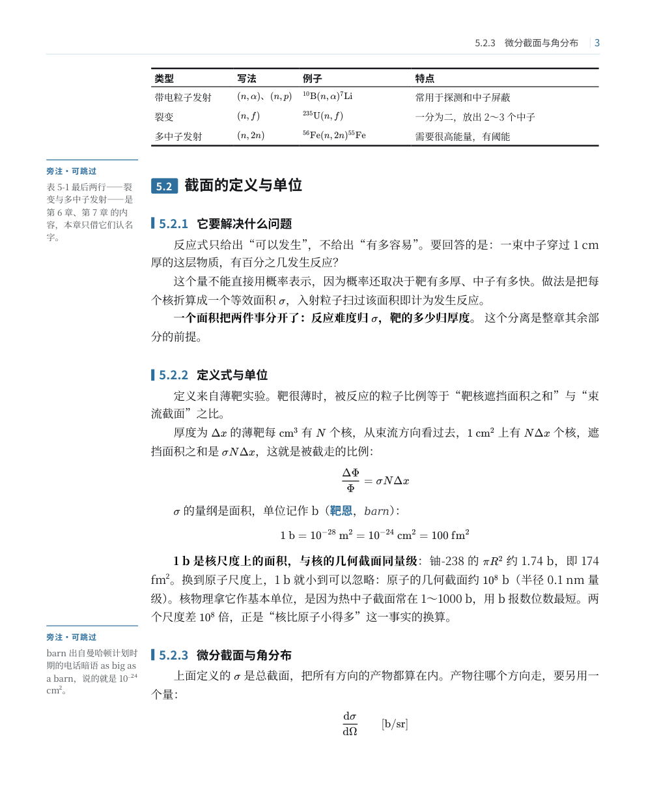
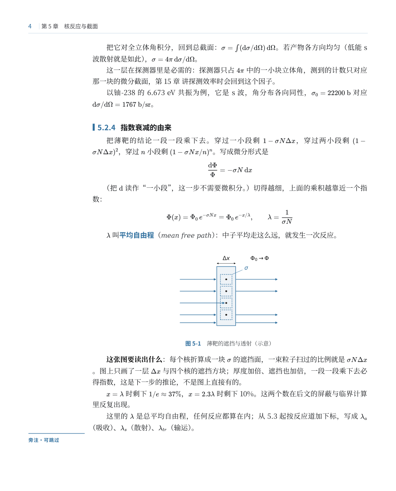
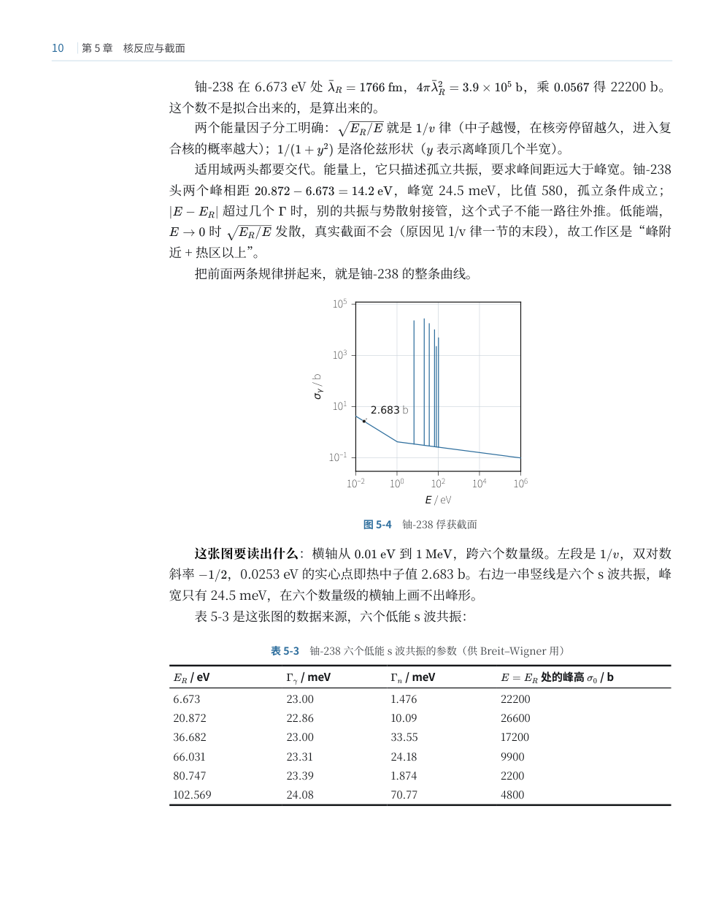
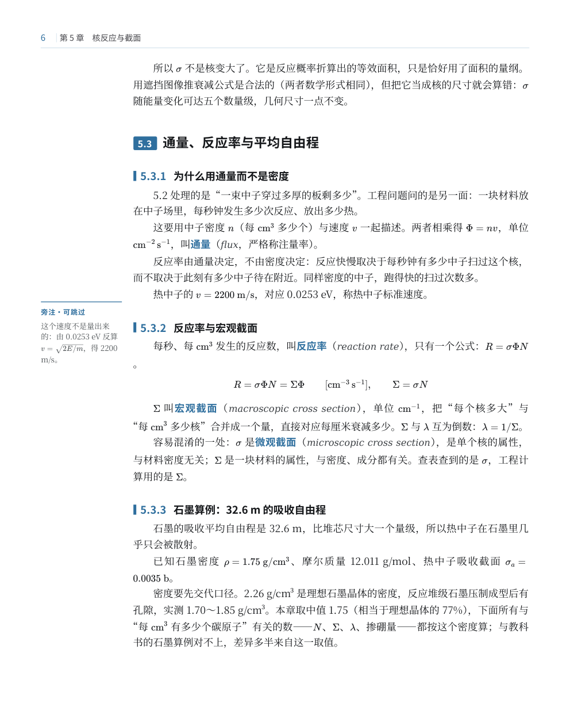

# cn-textbook-layout-kit

用 Markdown 写书，排成 210×260 mm 的中文教材 PDF。

左边留 34 mm 副区，旁注和题号放那儿，正文不受干扰。三线表的列宽按内容算，不靠猜百分比。插图走 SVG，文字是矢量，缩放不糊。书末能出题解章、附录和术语索引。

版式参照北京大学出版社《基础有机化学》第 4 版，只借版式语言，不含其中内容。

## 效果

| | |
|---|---|
|  |  |
| 章首页：左边色砖带章号，正文从副区右侧起排 | 三线表：上下 1.5 pt、表头线 0.75 pt，列宽按内容算 |
|  |  |
| 示意图 58 mm，标注全留，图内字就是图注字 8.5 pt | 数据图 65 mm，图内不留解释字，只剩轴和曲线 |
|  |  |
| 旁注落左副区，正文照常往下走 | 书末题解：问题／解（公式｜虚线｜解析）／答 |

成品是 20 页的 `05-样张/样张-第5章.pdf`（2.5 MB）。正文和题解的 Markdown 也在同一目录，可以直接拿去改。

## 规格

| | |
|---|---|
| 开本 | 210 × 260 mm |
| 页边距 | 天头 22，地脚 15，左右各 15 |
| 版心 | 180 × 223 mm，其中左副区 34 + 主栏 146 |
| 正文 | 10.5 pt / 17.2 pt，39 字 × 36 行 |
| 页眉 | 基线距纸顶 15 mm，细线 17.6 mm；页码贴切口，偶页章名、奇页节名 |
| 颜色 | 黑 + 墨蓝 `#2f6f9f`（章首色砖 `#1e4a6b`） |
| 图 | 宽 ≤65 mm（点名宽图 ≤180 mm）、高 ≤78 mm，图内字 8.5 pt；轴与曲线 0.75 pt、网格 0.4 pt |
| 表 | 上下框线 1.5 pt、表头线 0.75 pt；表内 9.5 pt；首列必占一行 |
| 前置页 | 封面（右对齐书名、红色版次标、顶部重复纹样）→ 封二空 → 版权页 → 目录（三层，每章一块双栏） |

## 依赖

pandoc、Chromium/Chrome、python3（matplotlib、Pillow）、PyMuPDF、KaTeX 离线包、Noto Serif/Sans CJK SC 字体。

PyMuPDF 不在系统 python 里时，构建时用 `PYMUPDF=<解释器>` 指过去。`finish.py`、`toc_pages.py`、`index_pages.py` 都要它。

## 跑起来

```
书目录/
  src/ch01.md           正文
  src/tijie_ch01.md     题解（HTML 片段）
  src/part0.md          卷首
  code/fig_ch01.py      插图脚本（可选）
  图/                   插图输出
  版式/                 把 04-模板/ 和 03-工具/ 放进来
```

```bash
cd 书目录/版式

# 单章：先验管线
python3 工具/figs.py ch01                 # 有插图时先出图
cp 04-模板/src/template.html src/         # 首次
PYMUPDF=python3 ./build.sh ch01 ch01.md tijie_ch01.md

# 全书：封面 → 版权页 → 目录 → 卷首 → 各章 → 题解章 → 附录 A–E
CHAPTERS="01 02" OUTNAME=试装 ./build_book.sh
OUTNAME=全书 ./build_book.sh
```

`build.sh` 依次做：替换 `{{ref:}}` 交叉引用、摘走章内习题只留题干、插图引用改 `.svg`、pandoc 转 HTML、`shape.py` 塑形、Chromium 打印、`finish.py` 补页眉页码书签。

`build_book.sh` 在这个基础上加封面、版权页、三层目录、附录，最后把真实页码回填进目录和术语索引。

出完先量字号：`python3 02-技能-book-typography-cn/scripts/measure_pdf.py out/sample.pdf`。正文该在 10.4–10.6 pt。要是读到 8.7 pt，说明整页被缩放了，先看下面第 1 条。

全书装一遍约三分半，Chromium 分页渲染吃掉其中三分钟。少装几遍，比优化脚本划算。

## 目录

```
01-技能-hep-textbook-rebuild/   整书重排流程：三十条踩过的坑、子代理任务模板、装配与缩放诊断
02-技能-book-typography-cn/     中文书排版通用知识与量尺脚本
03-工具/                        22 个 Python 工具，外加《图表规格 v3》
04-模板/                        template.html（全部 CSS）+ build.sh（单章）+ build_book.sh（全书）
05-样张/                        第 5 章正文、题解、20 页成品 PDF、六张示范页
```

| 工具 | 作用 |
|---|---|
| `shape.py` | 章首页色砖、节题色牌、三级标题编号、边注位置、章末题干、表格定宽、图宽判定、题解列宽 |
| `finish.py` | 页眉、页码、书签（PyMuPDF 后画） |
| `make_front.py` `make_cover.py` | 版权页与三层目录；封面顶部重复纹样 |
| `make_appendix.py` | 由各章定稿生成附录 D（术语索引，拼音序）与附录 E（插图目录） |
| `toc_pages.py` `index_pages.py` | 从成品 PDF 取回真实页码，写回目录与索引 |
| `normalize_captions.py` `fix_quotes.py` | 表题挪到表后、直引号换中文引号 |
| `figs.py` `bookstyle.py` `figstyle_v3.py` | 出图：双色 + SVG 矢量字，画布按印刷宽度校准 |
| `figcheck.py` | 按《图表规格 v3》验收 SVG：宽高、基准字号、线宽档 |
| `文风检查.py` `验收章.py` `规范检查.py` `term对齐.py` | AI 腔与加粗密度、章骨架体检、GB 3100/3101/3102 硬伤扫描、术语表与正文首现对齐 |
| `对照图.py` `线宽.py` `pages.py` `check_left.py` `measure.py` | 新旧页并置、量线宽、抽页、量左沿、从书影量版式参数 |

## 几处容易踩到的地方

1. **整页被缩到 83%**。用 `main` 的 `padding-left` 让出副区，Chromium 打印时把这个 padding 算成额外宽度，整页等比缩小。页边距看着还正常，字号已经从 10.5 掉到 8.7。改成给每个子元素加 `margin-left`，满幅元素单独归零。
2. **某一段单独钻进副区**。给这类段落写过 `margin` 简写，会覆盖掉上面的 `margin-left`。只写 `margin-bottom`。
3. **表格列宽改不动**。pandoc 用 `use-width` 给每个 `<col>` 写了行内宽度，样式表压不住；先删 `<colgroup>` 再自己写毫米值。
4. **表格量宽虚胖一倍**。量之前要剥掉 LaTeX 源码（`\mathrm`、花括号、`^_`），否则 `^{56}\mathrm{Fe}(n,n')^{56}\mathrm{Fe}^*` 会被当成三十多个字符，表格白白开进副区。
5. **线宽怎么设都是 0.75 pt**。Chromium 按 96 dpi 取整，1 pt 和 0.5 pt 落到同一个像素。图内线宽用 0.75／0.4 这种能落到整像素的值。
6. **目录后多一页空白**。`.tocpage{break-after:page}` 与下一章 `h1.chapo{break-before:page}` 叠在一起，Chromium 连断两次就多一页白页。断页只留一处：目录不写 `break-after`，交给章首页的 `break-before`。
7. **装书越装越慢**。`finish.py` 原先对每条标题都从当前页起扫一遍文本，377 页实测 199 s；改成先取一遍全文再定位，降到 2 秒级。
8. **版本化章节稿混进全书**。`ch05_v6.md`、`ch05_v7.md` 一起被 glob 并进去，同一章出现三遍、锚点重复。合并用精确 glob `src/ch[0-9][0-9].md`，题解单独按 `tijie_ch[0-9][0-9].md` 追加。

## 表格定宽算法

`shape.py: fit_tables()`

1. 格内 `①②③` 先各自起行；
2. 每列取「最长一条不折行」的宽度，首列必须占一行、不压缩；
3. 余量平均分给各列；
4. 主栏 146 放不下，开副区到 180；
5. 还不够，才在非首列的 `；`、`，`、`、` 处断行（只断该列最长的那格），断完重算；
6. 仍不够，首列不动，其余等比压缩。

## 图

数据图和示意图分开处理。数据图（曲线、谱线、条形）图内不留字，只留坐标轴与曲线；示意图（剖面、几何、流程）的标注是图的一部分，全部保留。

`figs.py` 把同一份画图脚本跑两遍（保留 / 去字），再按名单各取所需。画布按印刷宽度出图（默认 65 mm，宽图 180 mm），插入时不缩放，所以图内 8.5 pt 就是纸上 8.5 pt。图注一句话，细则写进正文。

## 已知问题

- 行首标点：Chromium 打印不实现 `line-break:strict`，约一成行会以标点开头。U+2060 和 nowrap 片段都试过，无效。
- 宽图放不进当页就整页下移，页尾留白两三成。CSS 没解法，只能排版后期人工挪。
- 跨页的表只重复表头，没标「续表」。
- 同样内容改成 210×260，比 A4 多排约两成页。

## 看不懂文档的话

整包下载，丢给任意一个能读文件的 AI，附这句：

> 这是中文教材排版套件。读 `01-技能-hep-textbook-rebuild/SKILL.md` 和 `套件说明.md`，然后按里面的流程，把我 `src/` 下的章节排成书。

它会自己读参数、改路径、跑脚本。卡在环境上就把报错贴回去。

## 许可

MIT，见 [LICENSE](LICENSE)。代码和文档都可以直接用、直接改，保留版权声明即可。`05-样张` 里的正文是作者自己的书，只作排版示例。
