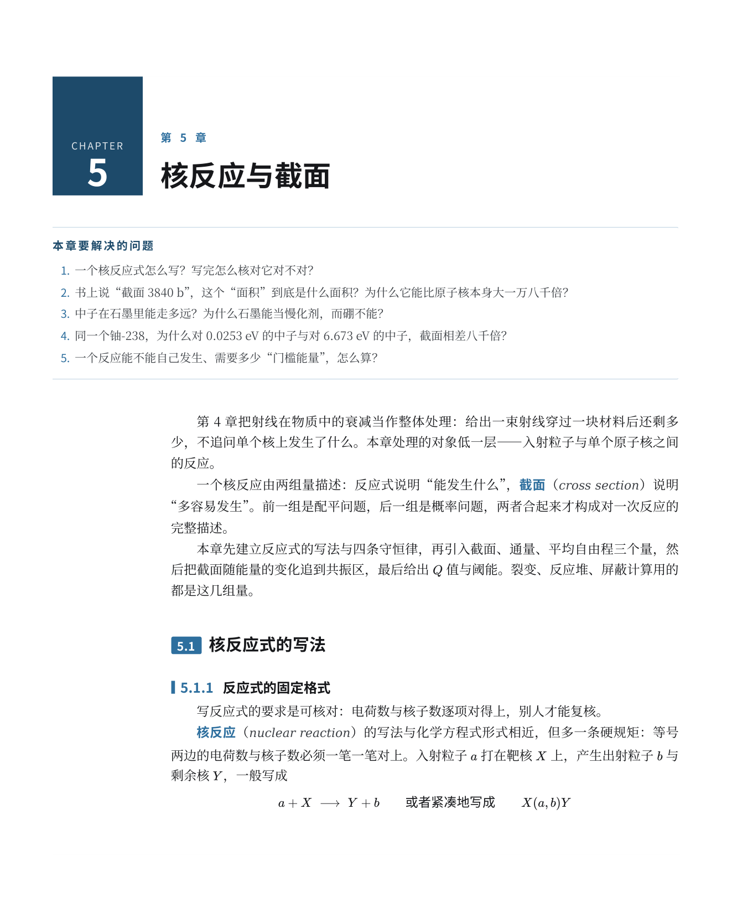
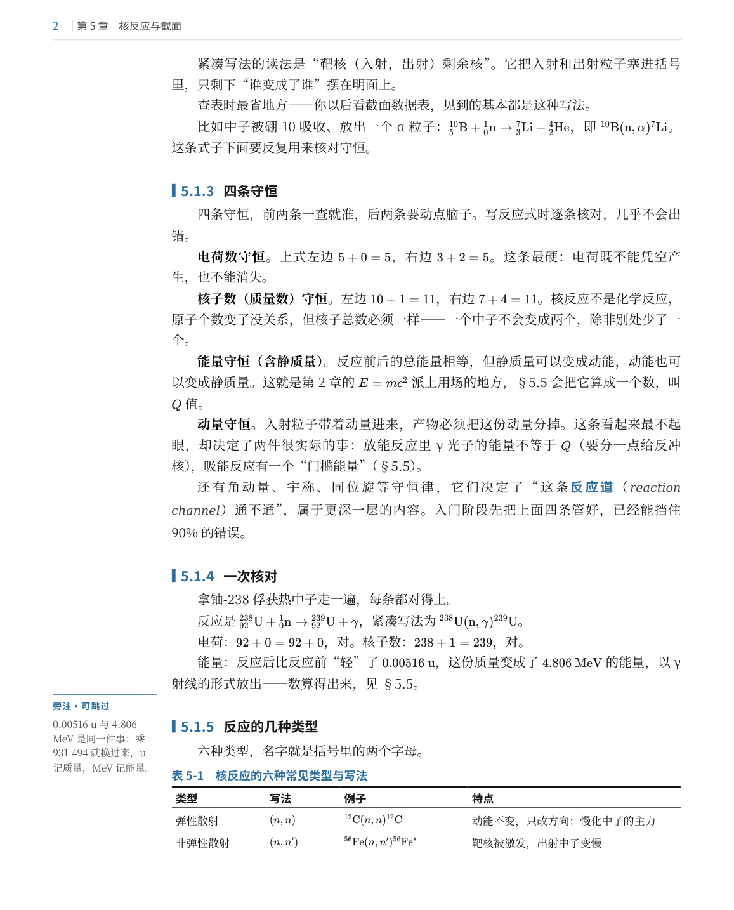
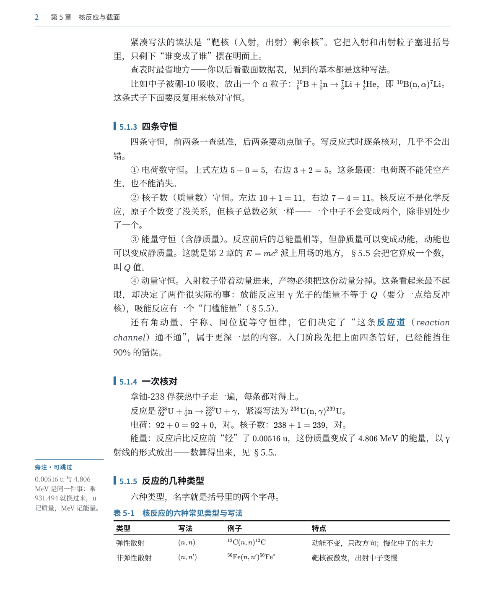
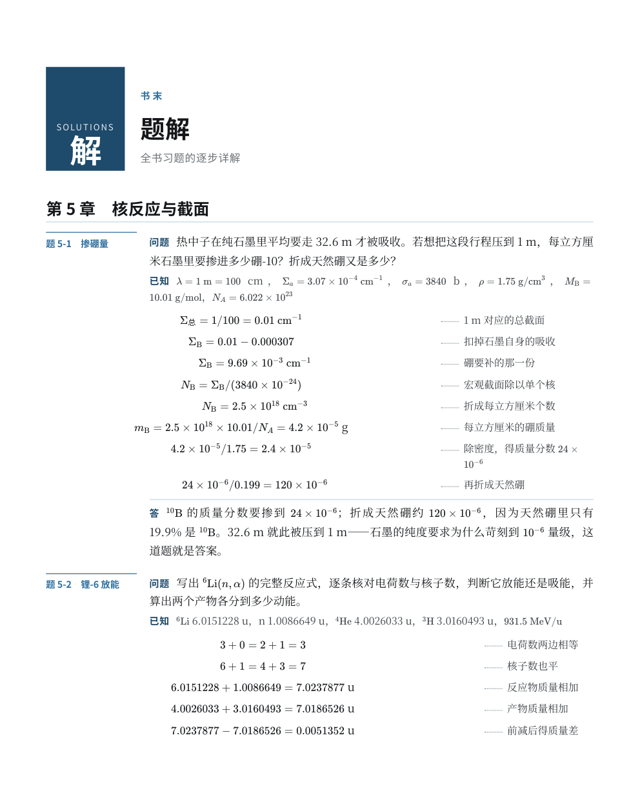

# cn-textbook-layout-kit

把 Markdown 写的书，排成 210×260 mm 的中文教材 PDF：左侧留 34 mm 副区放注释与题号，三线表按内容定宽，插图为 SVG（文字是矢量，缩放不糊）。

版式参考北京大学出版社《基础有机化学》第 4 版。只参考版式，不含其内容。

## 效果

| | |
|---|---|
|  |  |
| 章首页：色砖 + 章号，正文自副区右侧起排 | 三级标题连号 5.1.3；正文禁编号，只加粗名目 |
|  |  |
| 三线表：上下 1.5 pt、表头线 0.75 pt | 书末题解：问题／已知／解（公式｜虚线｜解析）／答 |

完整成品见 `05-样张/样张-第5章.pdf`（21 页）。

## 规格

| | |
|---|---|
| 开本 | 210 × 260 mm |
| 页边距 | 天头 22，地脚 15，左右各 15 |
| 版心 | 180 × 223 mm，其中左副区 34 + 主栏 146 |
| 正文 | 10.5 pt / 17.2 pt，39 字 × 36 行 |
| 页眉 | 基线距纸顶 15 mm，细线 17.6 mm；页码贴切口，偶页章名、奇页节名 |
| 颜色 | 黑 + 墨蓝 `#2f6f9f`（章首色砖 `#1e4a6b`） |
| 图 | 轴与曲线 1.5 pt，网格刻度 0.75 pt，图内字 8.5 pt（与图注同号） |

## 依赖

pandoc、Chromium/Chrome、python3（matplotlib、Pillow）、PyMuPDF、KaTeX 离线包、Noto Serif/Sans CJK SC 字体。

## 跑起来

```
书目录/
  src/ch01.md           正文
  src/tijie_ch01.md     题解（HTML 片段）
  code/fig_ch01.py      插图脚本（可选）
  图/                   插图输出
  版式/                 把 04-模板/ 和 03-工具/ 放进来
```

```bash
cd 书目录/版式
python3 工具/figs.py ch01                 # 有插图时先出图
PYMUPDF=python3 ./build.sh ch01 ch01.md tijie_ch01.md
```

`build.sh` 依次做：替换 `{{ref:}}` 交叉引用、摘走章内习题只留题干、插图引用改 `.svg`、pandoc 转 HTML、`shape.py` 塑形、Chromium 打印、`finish.py` 补页眉页码书签。

构建完先看字号：`python3 02-技能-book-typography-cn/scripts/measure_pdf.py out/sample.pdf`，正文应在 10.4–10.6 pt。落到 8.7 pt 说明整页被缩放了，多半是某个元素宽过版心（见「几处容易踩到的地方」第 1 条）。

## 目录

```
01-技能-hep-textbook-rebuild/   整书重排流程（含九个踩过的坑、子代理任务模板）
02-技能-book-typography-cn/     中文书排版的通用知识 + 量尺与自检脚本
03-工具/                        shape.py  finish.py  figs.py  文风检查.py
04-模板/                        template.html（全部 CSS）+ build.sh
05-样张/                        第 5 章正文、题解、成品 PDF、抽页 PNG
06-参考/                        bookstyle.py（matplotlib 封装）、对照报告
```

`shape.py` 干的事最多：章首页色砖、节题色牌、三级标题编号、边注位置、章末题干、表格定宽、图宽判定、题解列宽。

## 几处容易踩到的地方

1. **整页被缩到 83%**。用 `main` 的 `padding-left` 让出副区，Chromium 打印时把这个 padding 算成额外宽度，整页等比缩小——页边距看着正常，字号悄悄从 10.5 掉到 8.7。改成给每个子元素加 `margin-left`，满幅元素单独归零。
2. **某一段单独钻进副区**。给这类段落写过 `margin` 简写，会覆盖掉上面的 `margin-left`。只写 `margin-bottom`。
3. **表格列宽改不动**。pandoc 给每个 `<col>` 写了行内 `width:33%`，样式表压不住；要么 `!important`，要么删掉 colgroup 自己写毫米值。
4. **线宽怎么设都是 0.75 pt**。Chromium 按 96 dpi 取整，1 pt 和 0.5 pt 落到同一个像素。用 1.5 / 0.75 这种成倍的数。
5. **表格量宽虚胖一倍**。量之前要剥掉 LaTeX 源码（`\mathrm`、花括号、`^_`），否则 `^{56}\mathrm{Fe}(n,n')^{56}\mathrm{Fe}^*` 会被当成三十多个字符。

## 表格定宽算法

`shape.py: fit_tables()`

1. 格内 `①②③` 先各自起行；
2. 每列取「最长一条不折行」的宽度，首列必须占一行、不压缩；
3. 余量平均分给各列；
4. 主栏 146 放不下，开副区到 180；
5. 还不够，才在非首列的 `；`、`，`、`、` 处断行（只断该列最长的那格），断完重算；
6. 仍不够，首列不动，其余等比压缩。

## 图

两类分开处理：数据图（曲线、谱线）图内不留字，只留坐标轴与曲线；示意图（剖面、几何、流程）标注是图的一部分，全部保留。

`figs.py` 把同一份画图脚本跑两遍（保留 / 去字），再按名单各取所需。画布按印刷宽度出图，插入时不缩放，所以图内 8.5 pt 就是纸上 8.5 pt。图注一句话，细则写进正文。

## 已知问题

- 行首标点：Chromium 打印不实现 `line-break:strict`，约一成行会以标点开头。U+2060 和 nowrap 片段都试过，无效。
- 宽图放不进当页就整页下移，页尾留白两三成；CSS 没法解决，只能排版后期人工挪。
- 跨页的表只重复表头，没标「续表」。
- 同样内容改成 210×260，比 A4 多排约两成页。

## 看不懂文档的话

整包下载，丢给任意一个能读文件的 AI，附这句：

> 这是中文教材排版套件。读 `01-技能-hep-textbook-rebuild/SKILL.md` 和 `套件说明.md`，然后按里面的流程，把我 `src/` 下的章节排成书。

它会自己读参数、改路径、跑脚本。卡在环境上时，把报错贴回去就行。

## 许可

MIT，见 [LICENSE](LICENSE)。`05-样张` 里的正文是作者自己写的书，只作排版示例。
